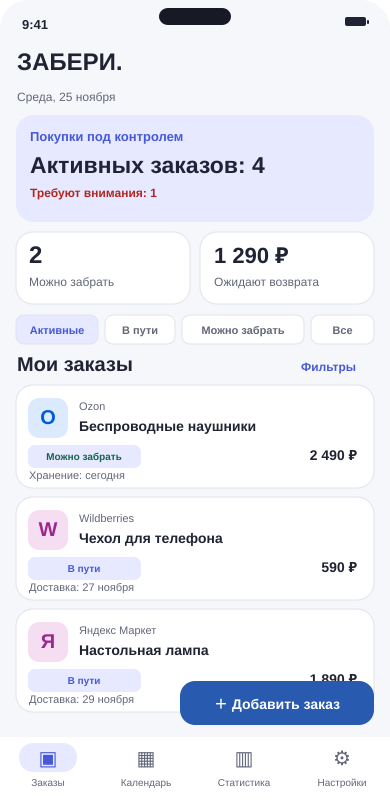
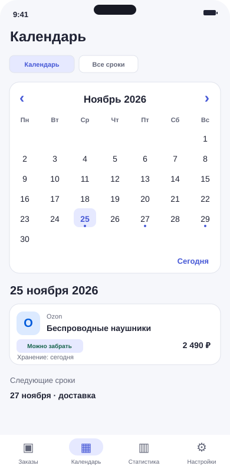

 

**Все заказы, сроки, возвраты и расходы — в одном приложении.**

Android 8.0+ · Бесплатно · Без регистрации · Основные функции офлайн

[**Официальный сайт**](https://epbloger.github.io/zaberi/) · [**Скачать в RuStore**](https://www.rustore.ru/catalog/app/ru.epbloger.zaberi) · [**Исходный код**](https://github.com/epbloger/zaberi/tree/main) · [**Поддержка**](mailto:helpmoorkis@yandex.ru)

---

## Скачать

**Уже в RuStore!** Первый публичный выпуск — 1.0.3. Бесплатно, для Android 8.0 и новее.

[**Скачать ЗАБЕРИ. в RuStore →**](https://www.rustore.ru/catalog/app/ru.epbloger.zaberi)

## Знакомьтесь: ЗАБЕРИ.

Покупаете в разных интернет-магазинах? ЗАБЕРИ. помогает помнить, что нужно получить, когда заканчивается срок хранения, какие деньги ещё должны вернуться и сколько на самом деле потрачено.

<table>
<tr>
<td align="center"> <b>Заказы</b></td>
<td align="center"> <b>Календарь</b></td>
<td align="center"> <b>Статистика</b></td>
</tr>
</table>
Демонстрация интерфейса приложения.
  
<a href="https://epbloger.github.io/zaberi/#screens"><b>Посмотреть интерактивную галерею и тёмную тему →</b></a>

## Что умеет приложение

| Возможность | Что это даёт |
|---|---|
| 📦 Учёт заказов | Все магазины в одном списке. Статусы, поиск, категории, фотографии и история. |
| ⏰ Напоминания | Сроки доставки, хранения и возвратов. Настраиваемые уведомления. |
| 🗓️ Календарь | Предстоящие события и важные даты в одном месте. |
| ↩️ Возвраты | Полные и частичные возвраты, ожидаемые суммы, исправление статусов. |
| 📊 Статистика | Фактические расходы с учётом полученных возвратов, разбивка по магазинам и категориям. |
| 📍 Пункты выдачи | Ручной ввод, сохранённые адреса, удобная карта и открытие маршрута. |
| 🌙 Оформление | Светлая, тёмная и системная темы. |
| 🔐 Резервные копии | Защита паролем, восстановление на другом устройстве и экспорт истории расходов в таблицу. |

## Как начать

1. Добавьте заказ вручную или через меню Android «Поделиться».
2. При передаче карточки через «Поделиться» проверьте автоматически заполненные поля. По желанию включите загрузку недостающей цены и главного фото из открытой карточки товара. Укажите фактическую оплату, сроки и при необходимости пункт выдачи.
3. Отмечайте получение и возвраты — история и статистика обновятся на основе введённых данных.

ЗАБЕРИ. не подключается к аккаунтам маркетплейсов и банков, не обновляет их статусы автоматически и не осуществляет платежи.

## Ваши покупки остаются у вас

Ваши заказы, фотографии и история покупок хранятся на вашем телефоне. Мы не храним их на своих серверах. Пользуйтесь основными функциями без регистрации и интернета.

Приложение бесплатное и содержит рекламу. Подробнее — в документах ниже.

| Документы | Ссылки |
|---|---|
| Политика конфиденциальности | [На сайте](https://epbloger.github.io/zaberi/privacy.html) · [Текст в репозитории](https://github.com/epbloger/zaberi/blob/main/app/src/main/assets/legal/privacy.md) |
| Условия использования | [На сайте](https://epbloger.github.io/zaberi/terms.html) · [Текст в репозитории](https://github.com/epbloger/zaberi/blob/main/app/src/main/assets/legal/terms.md) |
| Реклама и сторонние сервисы | [На сайте](https://epbloger.github.io/zaberi/ads.html) |
| Разработчик и контакты | [На сайте](https://epbloger.github.io/zaberi/developer.html) |

Все документы также доступны внутри приложения без интернета.

## Обратная связь

**Moorkis Development**

- [Официальный сайт](https://epbloger.github.io/zaberi/)
- [Сообщить об ошибке или предложить улучшение](https://github.com/epbloger/zaberi/issues)
- [Написать в поддержку](mailto:helpmoorkis@yandex.ru)

Не публикуйте в открытых обращениях личные данные, номера заказов, чеки, банковские реквизиты и пароли.

[Документация проекта](https://github.com/epbloger/zaberi/blob/main/docs/architecture.md)

© 2026 Moorkis Development. Все права защищены. [Условия использования исходных материалов](LICENSE).

© 2026 Moorkis Development. Все права защищены. [Условия использования исходных материалов](LICENSE).

---

<b>ЗАБЕРИ.</b> · Все покупки под контролем. Moorkis Development

